# Граф знань для рекомендаційної системи

Домашнє завдання 3 з дисципліни «NoSQL та векторні бази даних».

## 1. Опис проєкту

У цьому проєкті реалізовано графову базу даних для рекомендацій фільмів за допомогою Neo4j.

Використано [MovieLens 1M](https://grouplens.org/datasets/movielens/1m/) - датасет із фільмами, користувачами та їхніми оцінками.

Основні етапи роботи:
- Підготовка даних і проєктування графа.
- Завантаження вузлів і зв'язків у Neo4j.
- Виконання шести Cypher-запитів.
- Побудова рекомендацій і пошук найкоротших шляхів.
- Аналіз супервузлів та порівняння графової моделі з SQL.

Додаткові алгоритми GDS не виконувалися.

## 2. Структура проєкту

```text
Korniienko_nosql_3/
├── docker-compose.yml
├── convert.py
├── .env
├── .gitignore
├── import/
│   ├── movies.csv
│   ├── users.csv
│   └── ratings.csv
├── queries/
│   ├── part2_load.cypher
│   ├── part3.cypher
│   └── part4_supernodes.cypher
├── screenshots/
└── README.md
```

Оригінальні `.dat`-файли та `.env` не додаються до Git.

## 3. Налаштування та запуск

Для роботи використовуються Python 3.12, Docker Desktop і Neo4j 5.18 Community з APOC.

Завантажити [MovieLens 1M](https://grouplens.org/datasets/movielens/1m/) і розпакувати папку `ml-1m` у корінь проєкту.

Конвертувати `.dat` у CSV:

```powershell
py -3.12 convert.py
```

Після конвертації файли movies.csv, users.csv та ratings.csv будуть створені в папці import/.

Створити `.env` із параметром `NEO4J_AUTH`, використовуючи власний пароль:

```env
NEO4J_AUTH=neo4j/your-password
```

Запустити Neo4j:

```powershell
docker compose up -d
```

Відкрити Neo4j Browser: http://localhost:7474

У Neo4j Browser послідовно виконати запити з `queries/part2_load.cypher`: спочатку constraints і вузли, потім жанри та зв'язки, після цього пакетне завантаження рейтингів.

Після імпорту виконати запити з `part3.cypher` та `part4_supernodes.cypher`.

## 4. Частина 1 - Схема графа

Використано три типи вузлів і два типи зв'язків:

```text
(User {userId, gender, age, occupation})
    |
    | RATED {rating, timestamp}
    v
(Movie {movieId, title, year})
    |
    | HAS_GENRE
    v
(Genre {name})
```

**User** - користувачі, **Movie** - фільми, **Genre** - жанри.

Оцінка зберігається як ребро `RATED`, оскільки вона описує взаємодію між користувачем і фільмом. Значення оцінки та час є властивостями цього зв'язку. Це дозволяє швидко переходити від користувачів до оцінених фільмів. Окремий вузол `Rating` був би корисним, якби оцінка мала додаткові зв'язки або складну структуру, але для цього датасету він лише ускладнив би граф.

Жанри створено як окремі вузли `Genre`, а не як масив у `Movie`. Це дозволяє знаходити пов'язані фільми через `HAS_GENRE`, аналізувати популярність жанрів та розширювати їхні зв'язки в майбутньому. Недолік - додаткова кількість ребер і можливість утворення супервузлів.

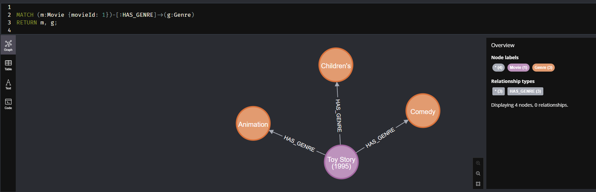

## 5. Частина 2 - Завантаження даних

Оригінальні файли MovieLens використовують роздільник `::` та кодування Latin-1. За допомогою `convert.py` їх перетворено на UTF-8 CSV.

Для ідентифікаторів вузлів створено три унікальні обмеження:
- `user_id_unique`
- `movie_id_unique`
- `genre_name_unique`

Вузли та зв'язки створювалися через `MERGE`, щоб уникнути дублювання при повторному запуску. Для імпорту рейтингів використано `apoc.periodic.iterate` з батчами по 5000 записів та `parallel: false`.

**Результати імпорту:**

| Елемент | Кількість |
|---|---:|
| User | 6040 |
| Movie | 3883 |
| Genre | 18 |
| HAS_GENRE | 6408 |
| RATED | 1000209 |
| Батчів імпорту | 201 |
| Помилок імпорту | 0 |

Усі 1 000 209 оцінок було успішно імпортовано. Пакетне завантаження дозволило уникнути однієї великої транзакції, яка могла б створити проблеми з пам'яттю.

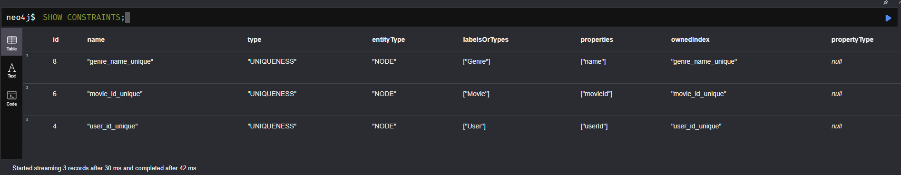

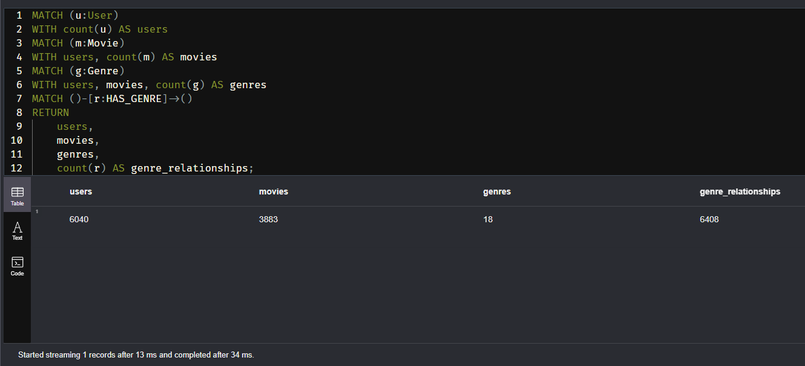

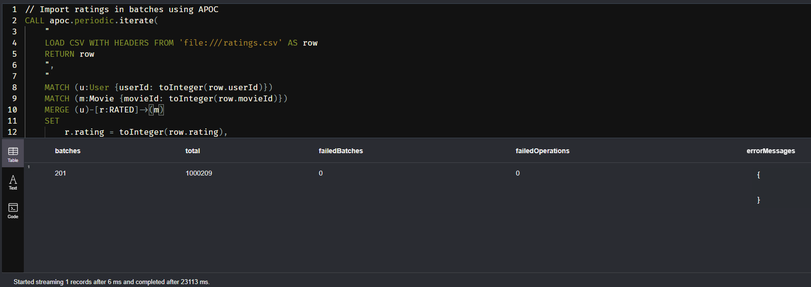

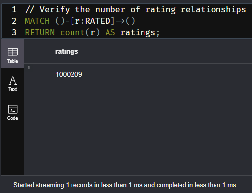

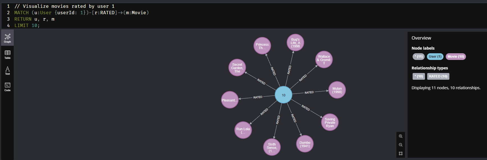

## 6. Частина 3 - Cypher-запити

Усі шість запитів збережено в `queries/part3.cypher`.

### Запит 1. Thriller з рейтингом вище 4.0

За допомогою `HAS_GENRE` знайдено фільми жанру Thriller, після чого через `RATED` обчислено їхній середній рейтинг.

Найкращі результати:
- The Usual Suspects (1995) - 4.52, 1783 оцінки.
- A Close Shave (1995) - 4.52, 657 оцінок.
- Rear Window (1954) - 4.48, 1050 оцінок.

Використано `MATCH`, `avg()`, `count()` та фільтрацію після агрегації.

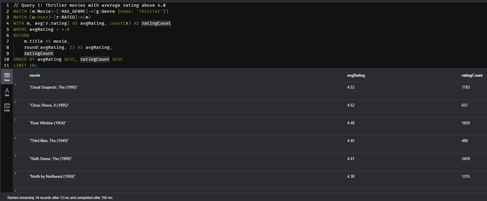

### Запит 2. Користувачі з понад 50 оцінками 5

Знайдено користувачів, які поставили п'ять зірок більш ніж 50 фільмам. Для цього відфільтровано ребра `RATED` за оцінкою 5 та підраховано їхню кількість для кожного користувача.

Найбільше таких оцінок мають користувачі:
- 4277 - 571
- 4169 - 476
- 3032 - 466

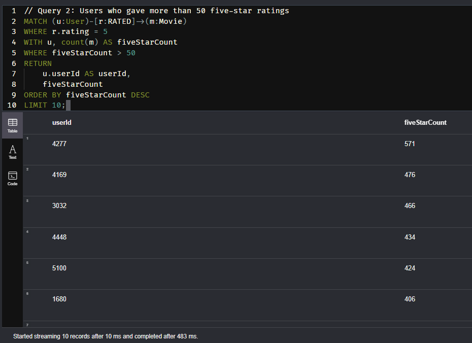

### Запит 3. Спільні фільми двох користувачів

Знайдено фільми, які користувачі 1 і 2 оцінили не нижче 4. У двох `MATCH` використано один вузол `Movie`, тому повертаються лише спільні фільми.

**Результат: 6 фільмів**, серед яких:
- Awakenings (1990)
- Dead Poets Society (1989)
- Saving Private Ryan (1998)
- One Flew Over the Cuckoo's Nest (1975)

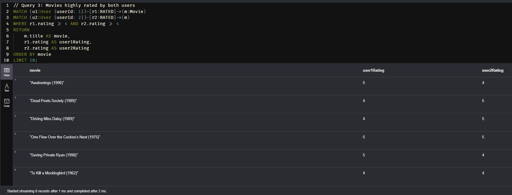

### Запит 4. Жанри з найвищими оцінками

Для кожного жанру через зв'язки `HAS_GENRE` та `RATED` обчислено середній рейтинг і кількість оцінок.

| Жанр | Середній рейтинг | Кількість оцінок |
|---|---:|---:|
| Film-Noir | 4.08 | 18261 |
| Documentary | 3.93 | 7910 |
| War | 3.89 | 68527 |
| Drama | 3.77 | 354529 |

Найвищий середній рейтинг має Film-Noir. При цьому Drama отримала значно більше оцінок.

Оскільки один фільм може мати декілька жанрів, його оцінки враховуються в статистиці кожного з них.

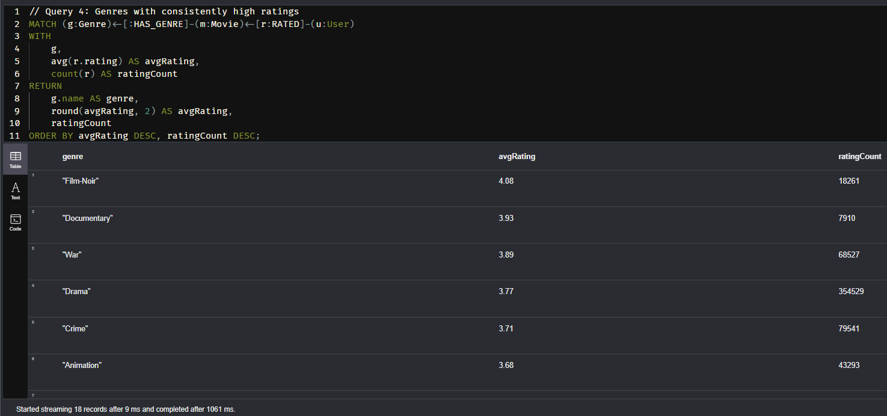

### Запит 5. Рекомендації фільмів

Реалізовано простий collaborative filtering для користувача 1.

Спочатку знаходяться користувачі, які високо оцінили щонайменше три ті самі фільми. Потім вибираються інші фільми, яким ці користувачі поставили оцінку не нижче 4. Уже оцінені цільовим користувачем фільми виключаються через `NOT EXISTS`.

Перші рекомендації:

| Фільм | Користувачів | Середній рейтинг |
|---|---:|---:|
| American Beauty (1999) | 2307 | 4.69 |
| Star Wars: Episode V (1980) | 2250 | 4.60 |
| The Silence of the Lambs (1991) | 2029 | 4.60 |
| Raiders of the Lost Ark (1981) | 2018 | 4.68 |

Такий підхід враховує спільні вподобання, але більше рекомендує популярні фільми, оскільки основним критерієм сортування є кількість користувачів.

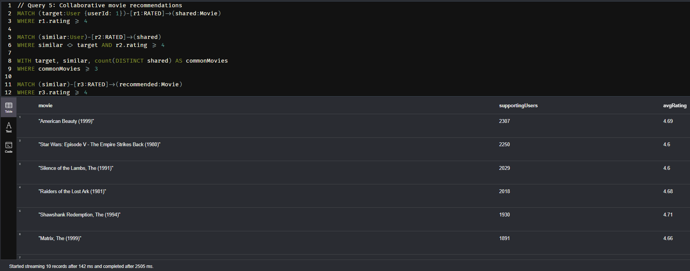

### Запит 6. Найкоротший шлях між користувачами

За допомогою `shortestPath()` знайдено найкоротший зв'язок між користувачами 1 і 2 через спільні фільми.

**Результат: довжина шляху 2.** Обидва користувачі оцінили фільм Awakenings (1990).

Довжина шляху означає кількість пройдених ребер `RATED`:
- **2** - два користувачі оцінили один спільний фільм.
- **4** - між користувачами є один проміжний користувач і два фільми.
- **6** - два проміжні користувачі та три фільми.

Довший шлях означає непрямий зв'язок через інших користувачів і фільми, але не обов'язково схожість їхніх смаків.

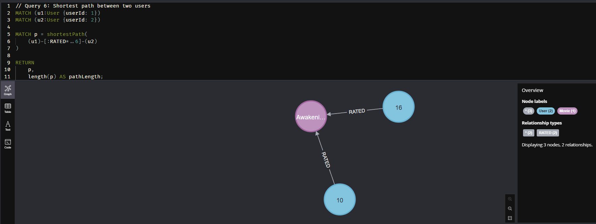

## 7. Частина 4 - Супервузли

Супервузли - це вузли з великою кількістю зв'язків порівняно з іншими.

Було перевірено фільми, користувачів та жанри.

| Тип | Вузол | Кількість зв'язків |
|---|---|---:|
| Movie | American Beauty (1999) | 3428 |
| Movie | Star Wars: Episode IV (1977) | 2991 |
| User | 4169 | 2314 |
| User | 1680 | 1850 |
| Genre | Drama | 1603 |
| Genre | Comedy | 1200 |

Такі вузли можуть сповільнювати запити, оскільки Neo4j доводиться обробляти багато ребер під час обходу графа. Індекс допомагає швидко знайти вузол, але не усуває витрати на перегляд його зв'язків.

Для оптимізації можна обмежувати обходи за оцінками або іншими умовами, а також попередньо обчислювати статистику для популярних фільмів і жанрів.

Зокрема, для великих жанрових вузлів `Drama` та `Comedy` можна зберігати готові показники кількості фільмів і середніх рейтингів, якщо ці дані часто запитуються. Це дозволить не перераховувати їх при кожному зверненні.

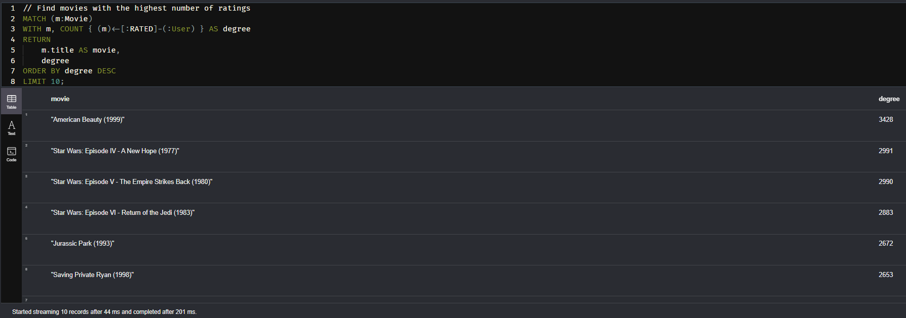

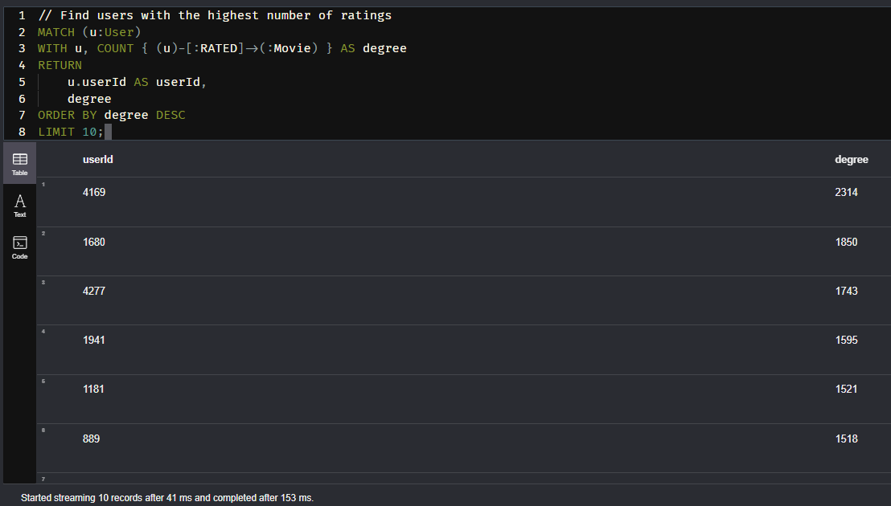

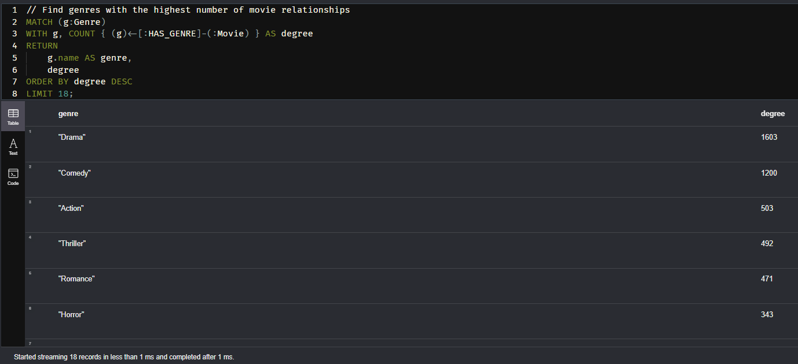

## 8. Частина 6 - Аналіз і висновки

### 8.1. Графова модель vs SQL

Усі шість запитів можна реалізувати і в реляційній базі даних. Проте для рекомендацій та пошуку шляхів графова модель часто зручніша, оскільки зв'язки між об'єктами вже представлені ребрами.

Наприклад, пошук спільних високо оцінених фільмів для двох користувачів у SQL виглядав би так:

```sql
SELECT
    m.title,
    r1.rating AS user1_rating,
    r2.rating AS user2_rating
FROM ratings r1
JOIN ratings r2
    ON r1.movie_id = r2.movie_id
JOIN movies m
    ON m.movie_id = r1.movie_id
WHERE r1.user_id = 1
  AND r2.user_id = 2
  AND r1.rating >= 4
  AND r2.rating >= 4;
```

У Neo4j для цього достатньо знайти два зв'язки `RATED` до одного вузла `Movie`.

Особливо корисна графова модель для запитів 5 і 6, де потрібно проходити кілька рівнів зв'язків. У SQL це теж можливо через `JOIN` та рекурсивні CTE, але запити часто стають складнішими.

### 8.2. Де реляційна модель краща?

SQL був би зручнішим для звітів, масових агрегацій та експорту табличних даних.

Наприклад, для розрахунку середнього рейтингу всіх фільмів або кількості оцінок за роками достатньо звичайного `GROUP BY`.

Реляційні бази також добре підходять для структурованих таблиць із чіткими зв'язками та регулярної аналітичної звітності. Тому графова модель не є заміною SQL для всіх задач.

### 8.3. Як покращити схему?

Для **запиту 1** можна додати до вузла `Movie` властивості `avgRating` і `ratingCount`. Тоді не потрібно буде щоразу обчислювати середній рейтинг через всі зв'язки `RATED`. Але ці поля треба оновлювати при додаванні нових оцінок.

Для **запиту 5** можна попередньо створювати зв'язки `SIMILAR` між користувачами з властивістю `similarityScore`. Це дозволило б швидше знаходити користувачів зі схожими смаками без повторного аналізу всіх спільних фільмів. Недолік - додаткові витрати на обчислення та підтримку таких зв'язків.

## 9. Загальний висновок

У цьому проєкті було побудовано графову базу MovieLens 1M з користувачами, фільмами, жанрами та понад мільйоном оцінок.

Було реалізовано шість Cypher-запитів, включно з рекомендаціями та пошуком найкоротших шляхів. Також знайдено супервузли та розглянуто способи оптимізації графа.

Графова модель виявилася зручною для роботи зі зв'язками між користувачами та фільмами. Водночас для простих агрегацій і звітів реляційна модель може бути практичнішою.

## 10. Джерела

- [MovieLens 1M - GroupLens](https://grouplens.org/datasets/movielens/1m/)
- [Neo4j Documentation](https://neo4j.com/docs/)
- [Cypher Manual](https://neo4j.com/docs/cypher-manual/current/)
- [APOC Documentation](https://neo4j.com/docs/apoc/current/)
